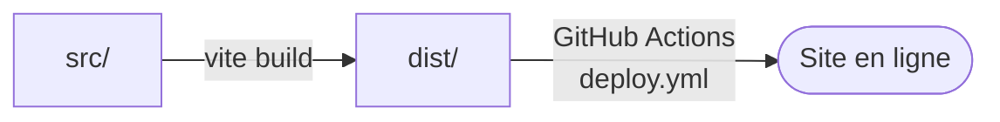

<div align="center">


# Portfolio

**Full-stack, bots & protocoles reverse-engineerés.**
*Mon portfolio en ligne : projets, stacks et contact.*

<br>


[Contenu](#-contenu) · [Démarrage](#-démarrage) · [Structure](#-structure) · [Déploiement](#-déploiement)

</div>

---

## ✨ Contenu

| Section | Description |
|---|---|
| **Hero** | titre animé, mains et rubans, rendu WebGL |
| **Projets** | TokiBot, JKPLM, Local Shield, LocalDownload, LocalScan : une vignette et une phrase par projet |
| **Stacks** | grille d'icônes (Bash, Chrome, Cloudflare, Discord, discord.js, Express, GitHub Actions, GitHub Pages…) |
| **Contact** | « Une idée, un projet ? » |

Animations au défilement (apparitions), navigation fluide.

## 🚀 Démarrage

```bash
npm install
npm run dev        # serveur de développement Vite
npm run build      # build de production
npm run preview    # prévisualiser le build
```

Seule dépendance de développement : **Vite**. Aucun framework.

## 📁 Structure

```text
Portfolio/
├── index.html
├── vite.config.js
├── public/              favicon
├── src/
│   ├── main.js          point d'entrée
│   ├── hero.js · gl.js · ribbons.js · mercury.js · background.js   rendu du hero
│   ├── nav.js · reveal.js                                           navigation, apparitions
│   ├── projects.js · stacks.js                                      données des sections
│   ├── runtime.js · chrome.js
│   ├── style.css
│   ├── fonts/
│   └── assets/          images des projets, icônes des stacks, mains
└── .github/workflows/deploy.yml
```

## 🧩 Déploiement



Chaque push déclenche le workflow `.github/workflows/deploy.yml`.

## 🔗 Projets présentés

| Projet | Description |
|---|---|
| **TokiBot** | bots temps réel pour JKLM.fun |
| **JKPLM** | jeu de mots multijoueur |
| **Local Shield** | bloqueur de publicités et de traqueurs |
| **LocalDownload** | détecteur de médias |
| **LocalScan** | lecteur de scans local |

---

<div align="center">
<sub>Fait par <a href="https://github.com/Tokinine">Tokinine</a></sub>
</div>
